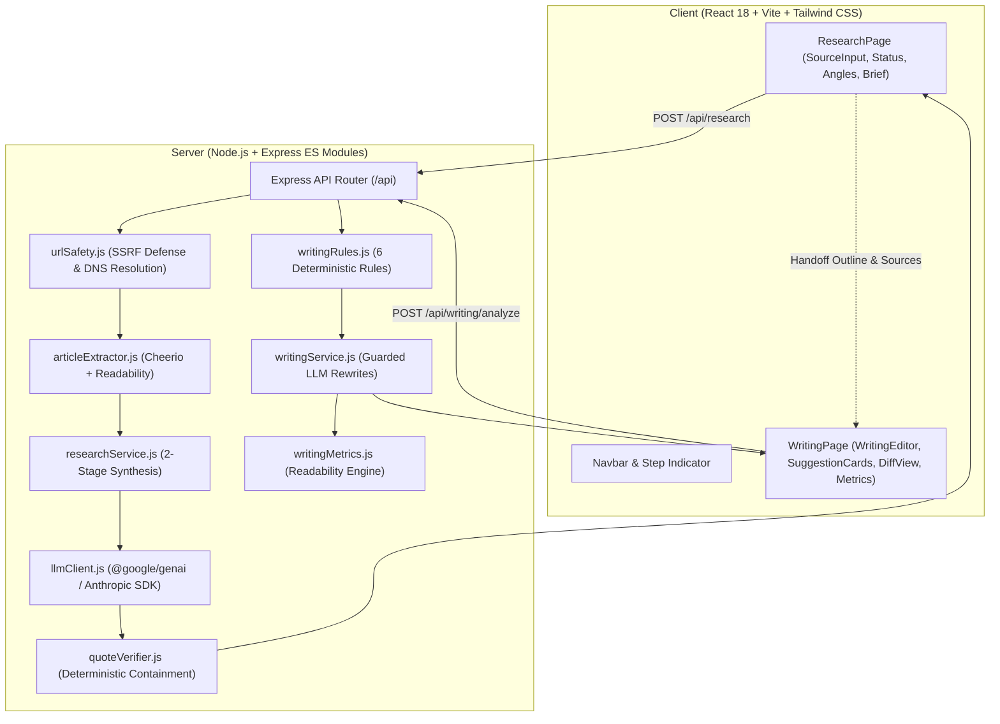

# AI Editorial Workspace

> **A high-signal editorial research and writing workspace built for *This Week in AI*.**  
> *Research smarter. Find the story. Write with evidence.*

---

## 1. Executive Summary & Deliverables Index

The **AI Editorial Workspace** is a production-grade editorial application designed to transition newsletter editors from raw, fragmented information to polished, evidence-backed drafts. 

Finding information is only half the battle: editors must connect the dots across conflicting announcements, discover an angle that matters to **founders, builders, and operators**, and produce clear, high-density writing without sacrificing factual nuance, entity accuracy, or authorial voice.

### Required Deliverables Index

| # | Deliverable | Description | File / Location |
| :-: | :--- | :--- | :--- |
| **1** | **Working Application** | Monorepo setup with unified `npm run dev` and zero-config local startup | [Quickstart Guide](#5-setup--local-quickstart) |
| **2** | **Source Code** | React (Vite) + Node.js (Express ES Modules) with **46 passing tests** | [`/client`](./client) & [`/server`](./server) |
| **3** | **Product & Engineering Note** | Architectural trade-offs, security invariants, heuristics, and editorial philosophy | [`docs/product-engineering-note.md`](./docs/product-engineering-note.md) |
| **4** | **Sample Editorial Output** | Fully sourced, 448-word newsletter story on AI coding agents with verified citations | [`sample/editorial-output.md`](./sample/editorial-output.md) |
| **5** | **Before-and-After Example** | Original draft, 7-item feedback log, accepted/rejected rationales, and metric deltas | [`sample/before-after.md`](./sample/before-after.md) |

---

## 2. Product Workflow & Architecture

The workspace connects two distinct capabilities into a continuous editorial loop:

```
[Raw Sources: URLs / Pasted Text]
               │
               ▼
┌────────────────────────────────────────────────────────┐
│               Part A: Research Assistant               │
│  - SSRF-hardened fetcher & readable text extraction    │
│  - Verbatim evidence quote extraction & verification   │
│  - Classifies Facts vs. Analysis vs. Speculation       │
│  - Breakdowns for Founders, Builders, Operators        │
│  - Synthesizes 2-3 defensible editorial angles         │
└────────────────────────────────────────────────────────┘
               │
               │ (One-Click Outline & Source Citations Handoff)
               ▼
┌────────────────────────────────────────────────────────┐
│         Part B: Writing Assistant (Hemingway Review)   │
│  - Pre-filled outline with thesis & verified links     │
│  - 6 deterministic quality rules (complexity, passive) │
│  - Guarded LLM rewrites (preserves entities & numbers) │
│  - Writer in control: Apply, Inline Edit, Dismiss, Undo│
│  - Safe exact-text matching & offset remapping         │
│  - Word-level DiffView & side-by-side comparison       │
│  - Editorial readability metrics with heuristics caveat│
└────────────────────────────────────────────────────────┘
               │
               ▼
[Final Polished Newsletter Issue with Verified Citations]
```

### Core Workflow Capabilities

#### Part A: Research Assistant
- **Input Flexibility**: Ingests 3 to 8 sources via public URL or direct text paste. When paywalls, Cloudflare bot challenges, or platform walls (e.g. X/Twitter) block direct scraping, the UI immediately surfaces a single-click fallback to paste the text directly.
- **SSRF & Ingestion Security**: All outbound URLs undergo rigorous pre-flight DNS resolution, blocking IPv4/IPv6 loopback, link-local, private, and cloud metadata ranges (e.g. `169.254.169.254`). Stream responses are capped at 5 MB to prevent memory exhaustion from oversized reports.
- **Verbatim Quote Verification**: The LLM is strictly prompted to extract verbatim supporting quotations. A deterministic verifier tests exact string containment and sliding-window fuzzy overlap against extracted source text, tagging each claim as **Verified Quote** or **Unverified Quote**. Verification guarantees textual presence in the source, not independent objective truth.
- **Three-Audience Implications**: Synthesized market developments explicitly delineate implications for:
  - **Founders & Execs**: Defensibility, moat shifts, and unit economics.
  - **Builders & Engineers**: Developer tooling, architectural trade-offs, and DX.
  - **Business Operators**: Cloud inference costs, deployment risk, and maintenance.
- **Defensible Angles**: Proposes 2–3 specific editorial theses with timeliness, counterpoints, and practical takeaways. An editor recommendation is surfaced with clear reasoning, while leaving the choice entirely to the editor.

#### Part B: Writing Assistant (Hemingway Review)
- **Writer Sovereignty**: The original draft is treated as an immutable baseline snapshot. Original text is never auto-overwritten.
- **6 Deterministic Quality Checks**:
  1. *Sentence Complexity*: Flags sentences $>30$ words (`warn`), $>40$ words (`strong`), and convoluted clauses ($\ge 3$ commas).
  2. *Passive Voice*: Identifies auxiliary be-verbs paired with past participles, offering active-voice subject inversions.
  3. *Filler Phrases*: 14 curated wordy phrases (e.g., "it is important to note that", "in order to", "at the end of the day") with concise replacements.
  4. *Acronyms & Jargon*: Highlights technical acronyms (`RAG`, `SWE-bench`, `LLM`, `MoE`, `MCP`) on first mention without expansion. Corporate buzzwords ("synergy", "paradigm shift") are flagged with precision guidance.
  5. *Repetitive Phrasing*: Detects consecutive sentence openers and close-proximity echoes within the same paragraph. Proper nouns (e.g. "Claude", "Anthropic", "Context") and words in separate paragraphs are deliberately protected from false-positive flagging.
  6. *Dense Paragraphs*: Identifies blocks $>120$ words that cause reader drop-off on mobile devices.
- **Actionable Writer-Controlled Revisions**:
  - **Apply Suggestion**: 1-click application of the recommended revision.
  - **Inline Edit**: Opens an embedded editor allowing the writer to customize the replacement text with **Apply** and **Cancel** controls.
  - **Dismiss**: Clears the suggestion without altering the draft.
- **Exact-Text Matching & Safe Offset Remapping**: Edits are validated against the actual draft text. If previous manual edits shifted character positions, exact-text matching safely finds the intended occurrence and updates downstream issue offsets.
- **Word-Level Diff & Version Comparison**: Provides Word Diff (additions/deletions), Side-by-Side comparison, Clean Revised copy, and Original Baseline snapshots.
- **Readability Metrics Without Dogmatism**: Computes word count, average sentence length, estimated reading time (~238 wpm), passive voice share, and Flesch Reading Ease & Grade Level. Includes an explicit disclaimer: *Readability scores are rough heuristics, not quality verdicts. Technical nuance should never be stripped for the sake of a score.*

---

## 3. Technology Stack



- **Frontend**: React 18, Vite, Tailwind CSS, Lucide React, `diff` library.
- **Backend**: Node.js (ES Modules), Express, `@google/genai` (Gemini 2.5 / 3.5 Flash) / `@anthropic-ai/sdk` (Claude), Cheerio, `@mozilla/readability`, JSDOM, Zod, `ipaddr.js`.
- **Testing**: Vitest + Supertest (**46 automated unit and integration tests**).

---

## 4. Repository Structure

```
ai-editorial-workspace/
├── client/
│   ├── src/
│   │   ├── components/
│   │   │   ├── Navbar.jsx               # Compact header with step navigation & active angle pill
│   │   │   ├── SourceInput.jsx          # Source rows (URL/Text, Twitter detection, live counters)
│   │   │   ├── SourceStatusList.jsx     # Ingestion status badges (OK, Partial, Excluded/Failed)
│   │   │   ├── ResearchBrief.jsx        # Executive overview, developments, tensions & evidence
│   │   │   ├── AnglePicker.jsx          # Editorial angles with thesis, counterpoints & handoff CTA
│   │   │   ├── ClaimList.jsx            # Fact/Analysis/Speculation badges & quote verification
│   │   │   ├── WritingEditor.jsx        # Editorial drafting canvas with outline cross-reference
│   │   │   ├── SuggestionCard.jsx       # Writer-controlled feedback cards (Apply, Edit, Dismiss)
│   │   │   ├── DiffView.jsx             # Word-level diff & side-by-side comparison
│   │   │   └── WritingMetrics.jsx       # Readability metrics, tooltip definitions & caveats
│   │   ├── pages/
│   │   │   ├── ResearchPage.jsx         # Research Assistant view
│   │   │   └── WritingPage.jsx          # Writing Assistant & review canvas
│   │   ├── services/api.js              # Centralized frontend API client
│   │   ├── App.jsx                      # App root with scroll-reset & state management
│   │   ├── index.css                    # Editorial design system, scroll-padding & typography
│   │   └── main.jsx
├── server/
│   ├── src/
│   │   ├── routes/
│   │   │   ├── research.routes.js       # POST /api/research endpoint
│   │   │   └── writing.routes.js        # POST /api/writing/analyze endpoint
│   │   ├── services/
│   │   │   ├── urlSafety.js             # SSRF defense, CIDR range parsing & redirect checks
│   │   │   ├── articleExtractor.js      # HTML readability extraction & 5 MB stream cap
│   │   │   ├── researchService.js       # 2-stage research synthesis pipeline coordinator
│   │   │   ├── writingService.js        # Writing review pipeline & guarded LLM rewrites
│   │   │   ├── llmClient.js             # Unified Gemini / Claude client with JSON repair heuristics
│   │   │   └── quoteVerifier.js         # Exact & sliding-window quote containment verifier
│   │   ├── utils/
│   │   │   ├── writingRules.js          # 6 deterministic writing rules & offset remapper
│   │   │   ├── writingMetrics.js        # Flesch ease, grade level, and syllable engine
│   │   │   └── schemas.js               # Strict Zod schemas for all API payloads & outputs
│   │   ├── prompts/
│   │   │   └── researchPrompts.js       # Versioned system prompts with XML data isolation
│   │   ├── app.js                       # Express app configuration & error handling
│   │   ├── server.js                    # Server entry point
│   │   └── tests/
│   │       ├── research.test.js         # SSRF, quote verification, schemas & route tests
│   │       └── writing.test.js          # Rules, offset remapping, integrity guards & LLM tests
├── sample/
│   ├── editorial-output.md              # Final 448-word sample newsletter piece with citations
│   └── before-after.md                  # Human draft vs revised piece with feedback log
├── docs/
│   ├── product-engineering-note.md      # Product architecture, trade-offs & editorial judgment
│   ├── HOW_TO_PRODUCE_SAMPLE.md         # Step-by-step editorial workflow walkthrough
│   └── MANUAL_TEST.md                   # Systematic QA test matrix & edge case verification
├── .env.example                         # Documented environment template with placeholders
├── .gitignore                           # Excludes secrets, .env, and build artifacts
└── package.json                         # Monorepo workspaces configuration
```

---

## 5. Setup & Local Quickstart

### Prerequisites
- **Node.js**: v18.0.0 or higher
- **npm**: v9.0.0 or higher

### Installation & Execution

```bash
# 1. Clone the repository
git clone <your-repo-url>
cd ai-editorial-workspace

# 2. Install workspace dependencies for client and server
npm install

# 3. Configure environment
cp .env.example .env
# Edit .env to add your Gemini or Anthropic API key, or keep LLM_MOCK=true for instant local testing

# 4. Start both client and server concurrently
npm run dev
```

- **Frontend Application**: [http://localhost:5173](http://localhost:5173)
- **Backend API Server**: [http://localhost:4000](http://localhost:4000)
- **Health Check Endpoint**: [http://localhost:4000/api/health](http://localhost:4000/api/health)

---

## 6. Environment Variables Reference

| Variable | Default | Purpose |
| :--- | :--- | :--- |
| `LLM_PROVIDER` | `gemini` | LLM provider adapter (`gemini` or `anthropic`). |
| `LLM_API_KEY` | - | API key for Gemini or Anthropic. |
| `LLM_MODEL` | `gemini-3.5-flash-lite` | Model identifier (or `claude-3-5-sonnet-20241022`). |
| `LLM_MOCK` | `false` | When `true`, returns structured test fixtures without API calls or quota spend. |
| `LLM_DEBUG` | `false` | When `true`, logs raw provider responses safely with API keys redacted. |
| `PORT` | `4000` | Backend server port. |
| `CORS_ORIGIN` | `http://localhost:5173` | Allowed CORS origin for frontend requests. |
| `FETCH_TIMEOUT_MS` | `15000` | Fetch timeout in milliseconds for scraping source URLs. |
| `MAX_SOURCE_CHARS` | `30000` | Maximum character budget per extracted source text. |
| `MAX_SOURCE_BYTES` | `5242880` | Maximum response byte cap (5 MB) preventing memory exhaustion. |

---

## 7. Running Tests

The test suite validates SSRF defenses, quote verification algorithms, all 6 writing rules, exact-text matching, offset remapping, integrity guards, and API routes using Vitest:

```bash
# Run the complete test suite (46 tests)
npm test

# Run tests in watch mode
npm run test:watch
```

### Test Evidence
```
 RUN  v3.2.7 server

 ✓ src/tests/research.test.js (14 tests) 75ms
 ✓ src/tests/writing.test.js (32 tests) 319ms

 Test Files  2 passed (2)
      Tests  46 passed (46)
   Duration  3.06s
```

---

## 8. Deployment Guide

### Frontend on Vercel
1. Import repository on [Vercel](https://vercel.com).
2. Set Root Directory: `client`.
3. Framework Preset: `Vite`.
4. Build Command: `npm run build` | Output Directory: `dist`.
5. Environment Variable: `VITE_API_BASE_URL` = your deployed backend URL.

### Backend on Render
1. Create a Web Service on [Render](https://render.com).
2. Set Root Directory: `server`.
3. Build Command: `npm install` | Start Command: `node src/server.js`.
4. Environment Variables:
   - `LLM_PROVIDER`: `gemini` (or `anthropic`)
   - `LLM_API_KEY`: your live API key
   - `LLM_MOCK`: `false`
   - `CORS_ORIGIN`: your deployed Vercel URL

---

## 9. AI Assistance Disclosure

> **Transparency Statement (per Assignment Brief Guidelines):**

### Tools Used
- **Agent**: Google Antigravity Agent (Gemini Flash Model)
- **LLM APIs**: Google Gemini Interactions API (`gemini-3.5-flash-lite` via `@google/genai`)

### What the Agent Implemented & Verified
- Monorepo architecture and npm workspaces configuration.
- SSRF security suite in `urlSafety.js` (IP CIDR parsing, DNS resolution, redirect hop validation).
- Content extraction engine with Readability, Cheerio, and 5 MB stream capping in `articleExtractor.js`.
- Deterministic quote verification algorithm with smart quote and whitespace normalization in `quoteVerifier.js`.
- Versioned system prompts with XML data isolation in `researchPrompts.js`.
- 6 deterministic writing rules, readability engine, and safe offset remapping in `writingRules.js` and `writingMetrics.js`.
- Guardrails preventing LLM rewrites from altering numbers, names, or URLs in `writingService.js`.
- React frontend components (`SourceInput`, `SourceStatusList`, `ResearchBrief`, `ClaimList`, `AnglePicker`, `WritingEditor`, `SuggestionCard`, `DiffView`, `WritingMetrics`).
- 46 automated tests with a 100% pass rate in Vitest.
- Complete documentation: `README.md`, `docs/product-engineering-note.md`, `docs/HOW_TO_PRODUCE_SAMPLE.md`, `docs/MANUAL_TEST.md`.

### What the Human Evaluated & Tested
- Manual verification of live URLs in the browser.
- Review and refinement of the sample editorial piece in `sample/editorial-output.md` and revision decisions in `sample/before-after.md`.
- End-to-end user experience testing of the research-to-writing handoff.

---

## 10. Submission Checklist

1. **Solution Live Link**: [TODO: Insert deployed Vercel URL]
2. **GitHub Repository Link**: [TODO: Insert GitHub repository URL]
3. **Repository README**: Fully documented in this file (`README.md`).
4. **All 5 Core Deliverables Complete**:
   - [x] Working Application (`npm run dev`)
   - [x] Source Code with complete tests (`npm test` — 46 passing tests)
   - [x] Product & Engineering Note (`docs/product-engineering-note.md`)
   - [x] Sample Editorial Output (`sample/editorial-output.md` — 448 words)
   - [x] Before-and-After Example (`sample/before-after.md` — 7-item revision log)
